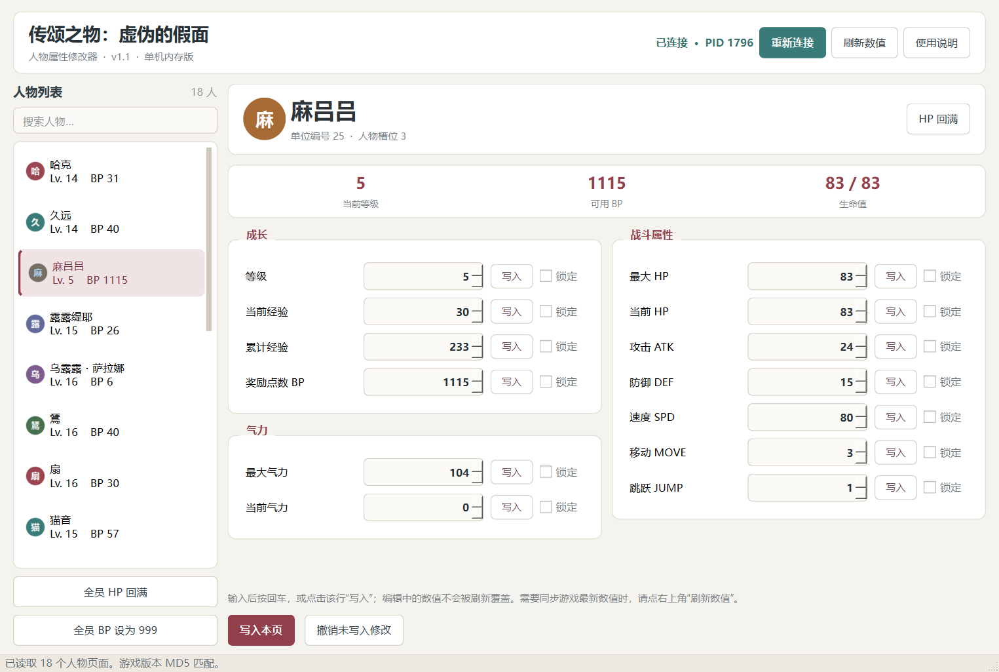

# Utawarerumono Mask of Deception Trainer: a single-task agent benchmark

[](https://github.com/twrsm666/utawarerumono-trainer-benchmark/actions/workflows/static.yml)

A reproducible case study of three agent sessions asked to build an intuitive, per-character Windows trainer for a 32-bit single-player game.

This repository publishes the measured timeline, sanitized source snapshots, acceptance tests, failure analysis, and the working Windows build. It is a **forensic single-task dossier**, not a general model leaderboard.

[中文（主版本）](README.md) · [Method](docs/METHOD.md) · [Results](docs/RESULTS.md) · [Timeline](docs/TIMELINE.md) · [Limitations](docs/LIMITATIONS.md)

## Result at a glance

| Run label | Platform | Measured wall clock | Delivered output | Acceptance result |
| --- | --- | ---: | --- | --- |
| **Hy4** | WorkBuddy | **81.97 min** | Python source only; no packaged EXE | **Not accepted.** Requires manual value-change scanning and its own final message acknowledges that its character values did not match the game. |
| **K3.1** | WorkBuddy | **30.09 min to first EXE**; **3.67 min follow-up fix** | Windows EXE + source + tests | **Accepted.** 18 character pages, 13 fields per page, live read/write verified, packaged self-test passed. |
| **Qwen4** | Qoder | **71.57 min** artifact window | Save editor EXE + source | **Not accepted for the requested UI.** 0/18 characters were named correctly because IDs were rotated by one slot; 108/108 sampled numeric fields belonged to the same slot and were shown under the next character's name. |

The labels **Hy4**, **K3.1**, and **Qwen4** are session/run labels supplied by the operator. Model attribution is not treated as independently verified. See [Limitations](docs/LIMITATIONS.md).

**Prompt asymmetry:** K3.1 received the complete per-character requirement in its first prompt. Hy4 started with a shorter request and received that requirement 40 minutes later. Qwen4's original prompt was unavailable. This is not a perfectly controlled head-to-head test.

## The task

The normalized benchmark instruction was:

> Build a trainer for this game. It must be intuitive: show a character page for every character, and allow the corresponding values to be edited freely.

The operator also supplied a 17 KB reverse-engineering handoff document. Both are preserved, with local paths redacted, in [task/](task/).

Target: `Utawarerumono Mask of Deception.exe` (32-bit PE, PE MD5 `c02107b577a8e3be7965b5b50594abfc`, size 6,130,176 bytes). The game and all game assets are **not** distributed here.



## What is actually proven

### Hy4

- 4 human turns, 51 assistant messages, 182 tool calls, 547 recorded events.
- Produced a 7-file Python/HTML source tree, but no standalone executable.
- Its final response states that it had confused `UnitData.bin` static templates with runtime character state and that its displayed values did not match the game.
- It replaced the requested fixed character pages with a manual "scan, change a value in-game, filter" workflow.
- Source is archived for audit: [artifacts/hy4](artifacts/hy4/).

### K3.1

- First request at `2026-11-08 18:03:40`; first packaged EXE at `18:33:45` (30.09 min).
- The operator reported one UI defect at `18:37:02`: typed values were overwritten by a 1.5 s auto-refresh before being committed.
- Fixed build produced at `18:40:42` (3.67 min after the report).
- The accepted build uses a validated static character table at module base + `0x6CE4A4`, 18 character pages, and 13 editable fields.
- Live verification: read 18 runtime characters, write and restore BP (`31 → 32 → 31`), packaged self-test `status=OK`.
- Source provenance: recovered from the agent platform's file history, rebuilt, and retested on 2026-11-11. The release is a **reproducible rebuild**, not asserted to be byte-identical to the deleted 2026-11-08 artifact.

Details: [K3.1 acceptance record](docs/K31_ACCEPTANCE.md).

### Qwen4

The failure is specific, reproducible, and more serious than a cosmetic label bug:

- All 18 parsed unit IDs equal the **next** runtime slot's unit ID (`18/18`).
- `0/18` character names match the actual same-slot character.
- All 108 sampled level/EXP/ATK/DEF/MOVE/JUMP values match the actual **same-slot** character (`108/108`).
- Result: each page shows one character's real progression under another character's name.
- The parser also maps `sp` to the runtime max-HP field and `hit` to the runtime speed field, so several labels are semantically wrong even when a number is correct.
- The save checksum was valid. **Checksum validity does not imply semantic correctness.**

Root cause and code references: [Qwen4 analysis](docs/QWEN4_ANALYSIS.md). Full machine-readable evidence: [comparison.json](evidence/qwen4/comparison.json) and [comparison.csv](evidence/qwen4/comparison.csv).

## Acceptance matrix

| Check | Hy4 | K3.1 | Qwen4 |
| --- | :---: | :---: | :---: |
| Stable per-character entry points | FAIL | PASS | PASS (rows exist) |
| Character names/IDs match the game | FAIL | PASS (18/18) | **FAIL (0/18)** |
| Runtime values match the same character | FAIL | PASS (live read) | **FAIL (labels shifted; 108/108 numeric fields belong to another name)** |
| Live edit persists and restores | NOT TESTED | PASS (`31→32→31`) | NOT SAFE TO TEST (save writer) |
| Standalone packaged executable | FAIL (none) | PASS | PASS (EXE exists) |
| Input/edit workflow usable | FAIL (manual scanner) | PASS (v1.1 input fix) | PARTIAL |

"NOT SAFE TO TEST" does not mean the writer necessarily fails. It means the audit did not write to the operator's real save because the character mapping was already proven wrong.

## Evidence and privacy

The raw agent logs are **not published**. They contain unrelated private conversations, a local username, absolute paths, and authentication material embedded in the final publication request.

What is published instead:

- Counts, timestamps, tool-call histograms, and wall-clock measurements.
- Sanitized source snapshots.
- The accepted binary and its tests.
- Read-only runtime evidence and checksums for rejected artifacts.
- Direct excerpts limited to the task outcome and self-correction.

The Qwen4 executable is also withheld: it embeds a local absolute path and is a save-file writer with a known bad mapping. Its size and SHA-256 are recorded in [artifact-inventory.json](evidence/qwen4/artifact-inventory.json). No `.DAT` save files, no extracted game data, no game executable, and no third-party trainer are included.

## Reproduce

### Accepted trainer

```powershell
cd artifacts/k31/trainer-source
python -m pip install PySide6-Essentials PyInstaller
python -m unittest discover -s tests -p "test_core.py" -v
python tests/ui_smoke_test.py
python tests/live_write_test.py
python build.py
```

Start the game, load a save, then run the resulting executable. Tests require the exact game build listed above and a running process.

### Qwen4 comparison

```powershell
# Start the archived Qwen4 save editor at 127.0.0.1:8765, then:
python scripts/capture_runtime_comparison.py
```

The script is read-only: it calls Qwen4's GET endpoints and uses `ReadProcessMemory`; it never writes game memory or save files.

## Releases

The accepted build is attached to the [v1.1-k31 GitHub release](https://github.com/twrsm666/utawarerumono-trainer-benchmark/releases/tag/v1.1-k31):

| Asset | Size | SHA-256 |
| --- | ---: | --- |
| `k31-trainer-v1.1.exe` | 36,407,921 | `fc56b3ca386e4823b0fe32ec11b3a957611ac3f094e592bdfaeea666380573da` |
| `qwen4-save-editor-rebuilt.exe` | 87,227,904 | `f01ce4fc20e557175e04f7bb17a554ad2c002065ef9e520299e144b898478460` |

The Qwen4 asset is a **neutral-path rebuild** of its own source, published only so the one-slot mapping error can be reproduced. Its original 93,733,376-byte binary is withheld because it embeds an operator-local absolute path. Do not use the Qwen4 editor on a real save: it writes save files and its character mapping is known to be wrong.

## Scope and fair use

- One task, one machine, one game build, one operator.
- Timing is wall-clock time, not model inference latency; it includes tool waits, installs, screenshots, tests, and human steering.
- The operator had already supplied a detailed reverse-engineering note. This is not a from-scratch reverse-engineering comparison.
- No blind randomization, repeated trials, token accounting, or provider-side telemetry.
- A pass means "met this task's acceptance matrix", not "best model".

## Rights

No affiliation with Aquaplus, Shiravune, DMM Games, WorkBuddy, Qoder, or any model provider. No game files or game assets are distributed. Character names and interface references remain the property of their respective rights holders. Source snapshots are published for inspection and reproduction of this benchmark; no additional license is granted.
