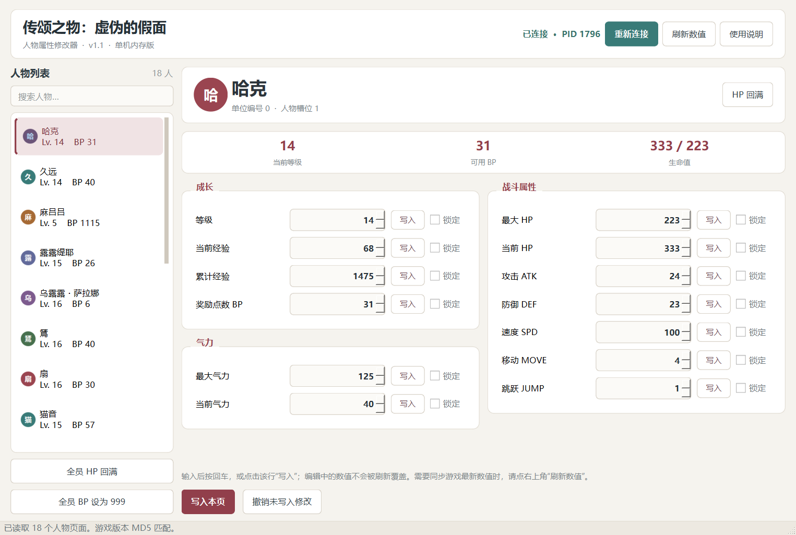
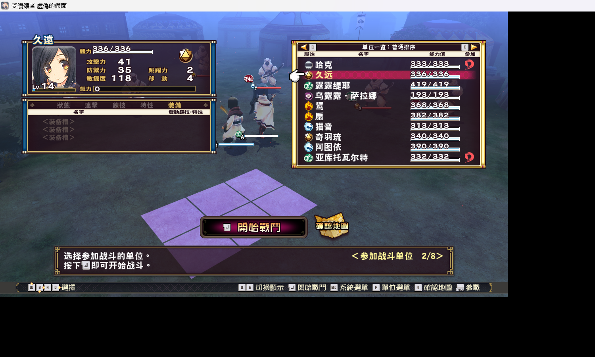
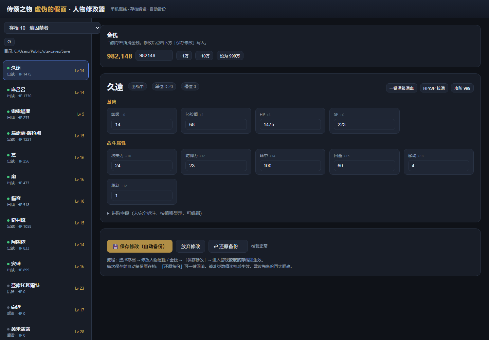

# 《传颂之物：虚伪的假面》人物修改器：单任务 Agent 实测档案

[](https://github.com/twrsm666/utawarerumono-trainer-benchmark/actions/workflows/static.yml)

同一个任务，三次 Agent 会话，三份可核查的产物与时间记录。

本仓库公开：脱敏后的完整源码、实机运行截图、验收脚本与日志、失败产物的逐行对照数据，以及通过验收的 Windows 可执行程序。它是一份**单任务取证档案**，不是模型排行榜。

[English](README.en.md) · [方法](docs/METHOD.md) · [结果](docs/RESULTS.md) · [时间线](docs/TIMELINE.md) · [限制](docs/LIMITATIONS.md) · [发布物](RELEASES.md)

---

## 一、结论速览

| 会话标签 | 平台 | 实测墙钟 | 交付物 | 验收结果 |
| --- | --- | ---: | --- | --- |
| **Hy4** | WorkBuddy | **81.97 分钟** | 7 个 Python/HTML 源文件，无 EXE | **未通过**。把静态模板当成运行时数据，最后改为手动扫描；其最终回复自认数值与游戏不符 |
| **K3.1** | WorkBuddy | **30.09 分钟出首个 EXE**；**3.67 分钟修复输入缺陷** | Windows EXE + 源码 + 测试 | **通过**。18 个人物页、每页 13 项、实机读写验证、打包自检通过 |
| **Qwen4** | Qoder | **71.57 分钟**（产物时间窗） | 存档修改器 EXE + 源码 | **不通过**。18/18 个角色 ID 错位到下一槽，0/18 名称正确，用户看到的每个人物都是别人的数值 |

> **标签说明**：Hy4、K3.1、Qwen4 都是操作者给出的会话/运行标签，不等同于服务商签发的模型身份。三种会话的提示词并不完全相同，详见[限制说明](docs/LIMITATIONS.md)。

---

## 二、K3.1：真正可用的那一版

### 实机运行截图

修改器窗口实拍（当前存档，哈克页面）：



同一时刻游戏内的角色面板，用于核对字段口径：



> 口径说明：修改器的“最大 HP”读的是**基础值**（`+0x88`），游戏面板显示的是**基础值 + 装备加成**的合计（`+0xB8` 的当前 HP）。例如哈克基础 223 + 装备 110 = 面板 333；久远 236 + 100 = 336；露露缇耶 319 + 100 = 419；麻呂呂无装备 83 = 83。截图里两者并不矛盾，这正是字段含义不同造成的差异，验收文档中已单独标注。

### 交付与验收

| 项目 | 结果 |
| --- | --- |
| 单文件 EXE | `k31-trainer-v1.1.exe`，36,407,921 字节，SHA-256 `fc56b3ca386e4823b0fe32ec11b3a957611ac3f094e592bdfaeea666380573da` |
| 人物页 | 18 页，每页 13 项可编辑字段 |
| 定位方式 | 模块基址 + `0x6CE4A4`，记录步长 `0x278`，连接时校验角色 ID 序列 |
| 写入验证 | 哈克 BP `31 → 32 → 31`，写入后回读、延时后仍稳定、再还原 |
| 打包自检 | `status=OK`、`pages=18`、`fields=13` |
| 边界 | 只读写运行中的进程内存；不改游戏 exe，不改存档文件 |

### 时间线（2026-11-08，UTC+8）

| 时间 | 事件 |
| --- | --- |
| 18:03:40 | 首个提示词，已包含“按人物分页、可随意修改”的完整要求 |
| 18:33:45 | 首个单文件 EXE 生成（30.09 分钟） |
| 18:37:02 | 操作者反馈：输入数值被自动刷新覆盖 |
| 18:40:42 | 修复版 v1.1 生成（反馈后 3.67 分钟） |

修复内容：取消 1.5 秒自动刷新；`textEdited` 立即标记待写入；刷新跳过焦点/待写入/锁定行；写入前 `interpretText()` 提交输入；增加回车即写入。详见 [K3.1 验收记录](docs/K31_ACCEPTANCE.md)。

---

## 三、Qwen4：看起来完整，但每个人物都是别人的数值

### 实机界面截图

Qwen4 存档修改器的运行界面（本地服务 `127.0.0.1:8765`，截图时以中性目录作为存档路径）：



左侧第一行显示“久遠”，右侧面板标注“槽位 0、單位ID 20”。而当游戏真实运行时，槽位 0 是**哈克（單位ID 0）**，槽位 1 才是久遠（單位ID 20）。界面本身是完整的、能读档、能显示 18 行——错的是身份与数值的对应关系。

### 可复核的量化结果

| 指标 | 结果 |
| --- | ---: |
| 解析出的角色行数 | 18 |
| 名称与同槽位真实角色一致 | **0 / 18** |
| 單位ID 等于**下一槽位**真实 ID | **18 / 18** |
| 等级／经验／攻击／防御／移动／跳跃 与同槽位一致 | **108 / 108** |
| 存档校验和 | 有效 |

也就是说：**数值不是随机编的，而是真实数据被贴到了下一个角色的名字下面。** 打开“久遠”看到的是哈克的成长数据，打开“麻呂呂”看到的是久远的，最后一行“哈克”显示的是第 17 槽的萨萨拉。

另外还有标签性错误：`sp`（`+0x0C`）实际是本审计中运行时的“最大 HP”值，`hit`（`+0x14`）实际是速度值。即使修正角色 ID，这些字段名仍然误导用户。

> 存档校验和只能证明文件结构没坏，**不能证明语义正确**。这也是本案例最值得记录的一点。

逐行数据：[comparison.csv](evidence/qwen4/comparison.csv) ／ [comparison.json](evidence/qwen4/comparison.json)。根因分析：[Qwen4 分析](docs/QWEN4_ANALYSIS.md)。

---

## 四、Hy4：把静态模板当成了运行时状态

- 4 轮人工输入、182 次工具调用、547 条事件，耗时 **81.97 分钟**。
- 交付 7 个 Python/HTML 源文件，没有可执行程序、没有构建脚本。
- 最终回复自认：给出的 `300 / 600 / 100 / 60…` 来自 `UnitData.bin` 静态模板，不是当前战斗中哈克的状态；HP／攻击／防御的标签也是猜的。
- 被指出后，它把默认页面改成“手动输入游戏中看到的数值 → 扫描内存 → 回游戏改数值 → 再筛选”的动态扫描流程。这与“每个人物一个固定页面”的要求不是同一个产品。

源文件与原始回复留档：[artifacts/hy4](artifacts/hy4/)、[最终回复原文](evidence/hy4/final-response.md)。

---

## 五、验收矩阵

| 检查项 | Hy4 | K3.1 | Qwen4 |
| --- | :---: | :---: | :---: |
| 可独立运行的程序 | 失败（无 EXE） | 通过 | 通过（EXE 存在） |
| 每个人物都有直达页面 | 失败（改为手动扫描） | 通过（18 页） | 通过（18 行） |
| 角色身份与游戏一致 | 失败 | 通过（18/18） | **失败（0/18）** |
| 数值属于同一角色 | 失败 | 通过（实机读取） | **失败（数值正确、名字错位）** |
| 写入可回读、可还原 | 未验证 | 通过（`31→32→31`） | 未做写入测试（映射已错，不做破坏性验证） |
| 边界安全 | 源码含存档写入 | 通过（仅进程内存） | 有备份机制，但可能写错角色 |

---

## 六、环境与复现

| 项目 | 值 |
| --- | --- |
| 系统 | Windows 11 10.0.26200 |
| 游戏 | `Utawarerumono Mask of Deception.exe`，32 位，6,130,176 字节 |
| 游戏 MD5 | `c02107b577a8e3be7965b5b50594abfc` |
| Python / UI | 3.13.14 64 位 / PySide6 6.12.0 |
| 打包 | PyInstaller 6.22.3 |

### 跑一遍 K3.1 的验收

```powershell
cd artifacts/k31/trainer-source
python -m pip install PySide6-Essentials PyInstaller
python -m unittest discover -s tests -p "test_core.py" -v
python tests/ui_smoke_test.py
python tests/live_write_test.py
python build.py
```

### 复现 Qwen4 的对照

```powershell
# 先启动归档的存档修改器（监听 127.0.0.1:8765），再执行：
python scripts/capture_runtime_comparison.py
```

脚本全程只读：只调用 Qwen4 的 GET 接口并用 `ReadProcessMemory` 读取游戏内存，不写内存、不写存档。

---

## 七、发布物

| 文件 | 大小 | SHA-256 | 说明 |
| --- | ---: | --- | --- |
| `k31-trainer-v1.1.exe` | 36,407,921 | `fc56b3ca386e4823b0fe32ec11b3a957611ac3f094e592bdfaeea666380573da` | K3.1 验收版，可直接运行 |
| `qwen4-save-editor-rebuilt.exe` | 87,227,904 | `f01ce4fc20e557175e04f7bb17a554ad2c002065ef9e520299e144b898478460` | Qwen4 存档修改器，**中性路径重建版**，仅用于复核映射错误 |

下载：[Release v1.1-k31](https://github.com/twrsm666/utawarerumono-trainer-benchmark/releases/tag/v1.1-k31)

关于 Qwen4 成品的两点必须说明：

1. 它的**原始 EXE**（93,733,376 字节，SHA-256 `4a6525a2c8657eb598cc18aa9b5ba5d005797ee428b9a55237b58427a3d2e4dd`）内嵌了操作者的本机绝对路径，因此不直接公开。
2. 公开的是**用其自带 `build_exe.js`、在中性路径下重建**的版本：仅把硬编码的存档目录改为按当前用户目录解析（`UTAWA_SAVE_DIR` 可覆盖），其余逻辑与其源码一致，重建后哈希为 `f01ce4fc…`。它的角色映射错误与原始版完全相同——这正是本案例要展示的东西。

> 警告：Qwen4 修改器会写存档且映射已知错误，**不要用它修改真实存档**。它在这里只作为失败证据存在。

Hy4 没有可执行产物，因此没有对应发布文件。

---

## 八、证据与隐私

不公开的内容：原始会话全文、游戏本体与任何游戏资源、`.DAT` 存档与备份、第三方修改器、含本机绝对路径的原始二进制。

公开的替代证据：时间戳与工具调用统计、脱敏源码、可执行文件与哈希、只读运行时快照、Qwen4 的逐行对照数据。

样本边界：一个任务、一台机器、一个游戏版本、一位操作者。耗时为墙钟时间，包含工具等待、依赖安装、截图、测试与人工干预，不是推理延迟。K3.1 与 Hy4 的提示词并不对等——Hy4 的分页要求晚了约 40 分钟才提出。

---

## 九、权利声明

与 Aquaplus、Shiravune、DMM Games、WorkBuddy、Qoder 及任何模型提供方均无隶属关系。不发行任何游戏文件或游戏资源；角色名称与界面素材归各自权利人所有。源码快照仅用于本档案的审阅与复现，不额外授予任何许可。
