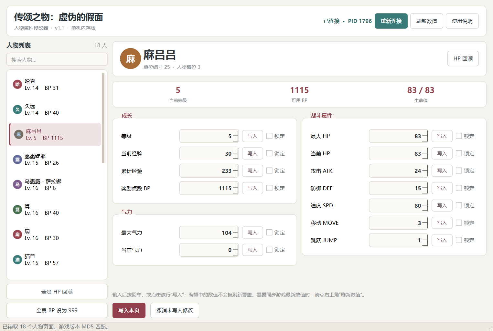

# 《传颂之物：虚伪的假面》人物修改器：单任务 Agent 实测档案

[](https://github.com/twrsm666/utawarerumono-trainer-benchmark/actions/workflows/static.yml)

本仓库记录三个 Agent 会话在**同一个任务族**上的实际过程、脱敏源码、验收结果与失败分析。目标是让结论可复核，而不是用单次样本制造模型排名。

[English README](README.md) · [方法](docs/METHOD.md) · [结果](docs/RESULTS.md) · [时间线](docs/TIMELINE.md) · [限制](docs/LIMITATIONS.md)

## 结果速览

| 会话标签 | 平台 | 实测墙钟时间 | 产物 | 验收结论 |
| --- | --- | ---: | --- | --- |
| **Hy4** | WorkBuddy | **81.97 分钟** | 仅 Python 源码，无独立 EXE | **未通过。** 退化为“人工改游戏数值后扫描筛选”，最终回复承认人物数值与游戏不一致。 |
| **K3.1** | WorkBuddy | **30.09 分钟出首个 EXE**；**3.67 分钟完成后续修复** | Windows EXE、源码、测试 | **通过。** 18 个人物页、每页 13 项；实机读写验证通过；打包自检通过。 |
| **Qwen4** | Qoder | **71.57 分钟产物时间窗** | 存档修改器 EXE、源码 | **不满足直观人物页要求。** 角色 ID 整体错位一槽：名称正确率 0/18，抽检的 108/108 个数值实际来自同一槽。 |

**边界先行：** Hy4、K3.1、Qwen4 都是操作者提供的**会话/运行标签**，不是经服务商确认的模型身份证。详见[限制说明](docs/LIMITATIONS.md)。

**提示词并不完全一致：** K3.1 首轮就收到完整的“每人物属性页”要求；Hy4 首轮只有简化要求，40 分钟后才补充该要求；Qwen4 的原始提示词未能取得。因此这不是严格受控的盲测对比。

## 任务原文（路径已脱敏）

> `<GAME_EXE>` 给我做个这个游戏的修改器 我要求直观的修改器：给出每个人物的属性页面，并可以随意修改对应数值 `@<HANDOFF_MD>`

操作者另提供了一份约 17 KB 的游戏结构交接文档。原文保留在 [task/](task/)。

目标程序：`Utawarerumono Mask of Deception.exe`，32 位 PE，MD5 `c02107b577a8e3be7965b5b50594abfc`，大小 6,130,176 字节。本仓库**不包含游戏本体、贴图、文本、存档或第三方修改器**。



## 可证明的事实

### Hy4：耗时最长，但没有形成可验收工具

- 4 轮人工输入、51 条助手消息、182 次工具调用、547 条记录，墙钟 81.97 分钟。
- 产出 7 个 Python/HTML 源文件，没有安装包或 EXE。
- 最终回复明确承认：把 `UnitData.bin` 的静态模板当成了运行时角色状态，界面数值与游戏不一致。
- 原定的“每人物属性页”被降级为“进游戏改数值后手动扫描筛选”。
- 源码原样归档于 [artifacts/hy4](artifacts/hy4/)。

### K3.1：首个可运行版本约 30 分钟，后续修复约 3.7 分钟

- `2026-11-08 18:03:40` 首轮请求。
- `18:33:45` 生成首个可运行 EXE，间隔 30.09 分钟。
- `18:37:02` 操作者报告输入框被自动刷新覆盖。
- `18:40:42` 修复版 EXE 完成，间隔 3.67 分钟。
- 最终版通过：18 人物页、每页 13 项、实机读取、BP 写入并还原（`31 → 32 → 31`）、独立 EXE 自检。
- 源码由平台文件历史恢复，2026-11-11 重新构建并复测。Release 是**可复现重构建**，不声称与已删除的原始 EXE 字节完全一致。

详见 [K3.1 验收记录](docs/K31_ACCEPTANCE.md)。

### Qwen4：不是“随机乱填”，而是系统性错位

只读核验结果：

- 18/18 个角色 ID 都等于**下一个槽位**的真实 ID。
- 0/18 个角色名称与同槽真实角色相符。
- 抽检的等级、经验、攻击、防御、移动、跳跃共 108/108 个数值，实际属于**同一槽位**的真实角色。
- 因此玩家看到的是：“久远”页里放着哈克的成长数据，“麻吕吕”页里放着久远的数据，依此类推。
- 另外，`sp` 字段实际对应运行时的最大 HP，`hit` 实际对应速度，字段语义也不正确。
- 存档校验和有效，但**校验和有效不等于人物映射正确**。

根因及代码行号见 [Qwen4 分析](docs/QWEN4_ANALYSIS.md)。机器可读证据见 [comparison.json](evidence/qwen4/comparison.json) 和 [comparison.csv](evidence/qwen4/comparison.csv)。

## 验收矩阵

| 检查项 | Hy4 | K3.1 | Qwen4 |
| --- | :---: | :---: | :---: |
| 稳定的逐人物入口 | 失败 | 通过 | 有 18 行，但人物归属错误 |
| 角色 ID / 名称正确 | 失败 | 通过（18/18） | **失败（0/18）** |
| 属性属于当前人物 | 失败 | 通过（实机） | **失败（数值来自同槽，名字后移一槽）** |
| 写入后持续并可还原 | 未验证 | 通过（BP 31→32→31） | 未写入真实存档，映射已足以判定不可验收 |
| 独立 EXE 可启动 | 无 EXE | 通过 | 有 EXE |
| 编辑流程可用 | 失败（手动扫描） | 通过（修复刷新覆盖后） | 部分可用 |

“未写入真实存档”不代表写入一定失败，而是因为人物映射已证明错误，继续写入只会污染存档，审计主动停止。

## 证据策略与隐私

**不公开原始会话全文。** 原始日志包含无关私人对话、本机用户名、绝对路径，以及发布请求中夹带的访问令牌。

公开的是：

- 时间戳、工具调用次数、墙钟统计；
- 脱敏后的源码快照；
- 通过验收的二进制及测试日志；
- 只读运行数据、校验和、失败对照表；
- 与任务结论直接相关的少量原文摘录。

Qwen4 的原始 EXE 同样不公开：它内嵌本机绝对路径，而且是带有错误映射的存档写入器。其大小与 SHA-256 已记录在 [artifact-inventory.json](evidence/qwen4/artifact-inventory.json)。全部 `.DAT` 存档、游戏解包数据、游戏 EXE、第三方修改器均未上传。

## 复现

### 验收通过的修改器

```powershell
cd artifacts/k31/trainer-source
python -m pip install PySide6-Essentials PyInstaller
python -m unittest discover -s tests -p "test_core.py" -v
python tests/ui_smoke_test.py
python tests/live_write_test.py
python build.py
```

必须先启动指定版本游戏并读取存档。测试依赖真实进程，不是纯离线单测。

### Qwen4 对照

```powershell
# 先启动归档的 Qwen4 修改器，使其监听 127.0.0.1:8765
python scripts/capture_runtime_comparison.py
```

该脚本是只读的：只调用 Qwen4 的 GET 接口并读取游戏内存，不写内存、不写存档。

## 发布物

GitHub Release 附带通过验收的 [`k31-trainer-v1.1.exe`](https://github.com/twrsm666/utawarerumono-trainer-benchmark/releases/tag/v1.1-k31)。SHA-256：`fc56b3ca386e4823b0fe32ec11b3a957611ac3f094e592bdfaeea666380573da`。

## 结论边界

- 单任务、单机器、单游戏版本、单操作者。
- 时间是从首条提示到产物落盘的墙钟，不是模型推理时延；包含工具等待、安装、截图、测试与人工介入。
- 操作者事先提供了详细逆向说明书，这不是从零逆向能力的比较。
- 没有盲测、重复试验、token 统计或服务商遥测。
- “通过”只表示满足本任务验收矩阵，不代表模型综合能力排名。

## 权利声明

与 Aquaplus、Shiravune、DMM Games、WorkBuddy、Qoder 及各模型提供方无隶属关系。不分发任何游戏文件或游戏素材。角色名称与界面引用归各自权利人所有。源码快照仅用于复核本测试，不额外授予再分发许可。
